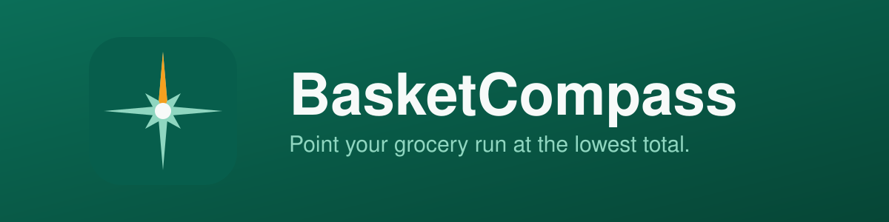

<p align="center">
  
</p>

<p align="center">
  <em>Point your grocery run at the lowest total: compare the items you actually buy across nearby stores, tax included.</em>
</p>

<p align="center">
  <a href="../../actions/workflows/pages.yml"></a>
  <a href="../../actions/workflows/authorship-guard.yml"></a>
  <a href="../../actions/workflows/restricted-content-guard.yml"></a>
  <a href="../../actions/workflows/release-build.yml"></a>
</p>

<p align="center">
  <code>Web PWA</code> &nbsp;·&nbsp; <code>Dependency-free</code> &nbsp;·&nbsp; <code>Offline-capable</code> &nbsp;·&nbsp;
  <code>Windows installer</code> &nbsp;·&nbsp; <code>IEC 62304 Class A</code> &nbsp;·&nbsp; <code>MIT</code> &nbsp;·&nbsp; <code>Public · test release 0.1.0</code>
</p>

---

> **Public and open.** This repository is public. Everything here is published to
> the world, so nothing confidential ever lands in a commit. Prices shown in the
> app are user-confirmed or demo samples; confirm final prices in store.

Postal code → store selection → single-item search or a saved list → price matrix
→ a shopping plan over up to three stores.

## Overview

BasketCompass is a dependency-free web Progressive Web App for grocery price
comparison. Enter a Canadian postal code to set your province and nearby store
banners, search a single item or run a reusable list (for example a weekly
grocery list), and the app builds a tax-aware price matrix across your selected
stores and recommends the cheapest complete-basket plan, accounting for a cost
per extra stop. Lists stay on your device; export and import move them between
devices. Live coverage uses the public épiceries.ca Quebec feed plus manual price
entry; broader flyer, all-retailer, and non-grocery coverage are future release
gates.

## Run locally

No dependencies or build step are required. Serve the `dist/` folder over
localhost — service workers and installation need HTTPS or localhost, so do not
open `index.html` from the filesystem:

```sh
python3 -m http.server 8080 --directory dist
# then open http://localhost:8080
```

Run the checks with `npm test`.

## Install

- **As a web app (PWA):** open the deployed site once over HTTPS, then use the
  browser's install prompt or the in-app Install button to add it to a phone home
  screen or desktop. The service worker caches only the local app shell for
  offline use and never caches third-party prices.
- **As a desktop app (Windows):** download `BasketCompass-Setup-<version>-Windows-x64.exe`
  from the latest [release](../../releases) and run it. It installs per-user (no
  admin needed); launching opens a small window that serves the app on
  `127.0.0.1` and opens your browser. Lists stay on your device; nothing is
  uploaded. The installer is built with PyInstaller + Inno Setup; see
  [Build & release](#build--release).

## Test the complete flow

1. Enter H7N 1A1, select stores, and continue.
2. Select Offline demo prices and load the sample weekly list.
3. Change quantities, disable an item, and change maximum stores and extra-stop cost. Confirm the matrix and plan update.
4. Create, duplicate, rename and delete lists. Reload and check persistence.
5. Export a JSON backup. Import it; imported copies preserve current lists.
6. Add a manual Costco price, package size, tax category and optional deposit. Compare it.
7. In live mode, search `lait` or `organic milk`, select an exact product, confirm tax, then add it to a list.
8. Open once online, then test offline reload and saved lists. Use the Install app instructions for phone or desktop.

## Known limits — do not represent as full live coverage

- The documented public épiceries.ca adapter covers six Quebec banners, not branch-specific prices. The original development environment blocked outbound API requests (HTTP 403); successful real API responses and cross-origin behaviour have not been independently verified. Contract fixtures test mapping only. The app surfaces failures and never falls back silently to demo prices.
- Costco has manual price entry, a retailer link and a maps search. Automatic Costco prices and all-retailer flyer aggregation are not implemented.
- Postal-code syntax and province are resolved locally. This is not a deliverability validator, store locator, radius filter or distance service. Locations are checked with external maps.
- Product matching is user-confirmed exact SKU selection. Brand/organic requirements are not inferred. Saved items retain observed offers, which are excluded after seven days or expiry. No silent substitute products.
- Tax uses confirmed item categories and current standard province rates; product-specific provincial exemptions, special levies, coupon treatments and cash rounding require verification. Unknown tax prevents full checkout recommendations. Deposits must be entered manually. Rates verified 2026-10-03 against CRA and Revenu Québec.
- Shopping plans enumerate selected store combinations, round up to whole packs, require a complete basket and apply a user-entered per-extra-stop cost. They do not compute routes, historical deal scores or membership fees.
- Local storage is not encrypted. Browser data clearing/eviction removes it. Export/import supports backups and device transfers; there is no automatic synchronization or account system.
- Browser visual/interaction and installed-device QA were unavailable in the supplied environment. Do not claim 100% acceptance or production readiness.

## Architecture

```
dist/
  index.html            app shell and markup
  App.js                rendering, local persistence, search/list workflows, backups, install help
  Engine.js             deterministic postal, size, tax, matrix, complete-basket optimization, backup validation
  Provider.js           documented public feed adapter, cache, query aliases, demo samples
  ServiceWorker.js      local app-shell cache only; rejects redirected/auth pages, never caches external prices
  Style.css             styles
  Icon.svg, Icon-*.png  app icons (generated from brand/)
brand/                  computed brand assets + GenerateBrand.py (incl. Icon.ico)
tests/                  node --test suites for Engine and Provider
scripts/CheckCommits.py commit-metadata policy check (used by CI)
installer/Launcher.py   serves dist/ on 127.0.0.1 and opens the browser (frozen into the desktop app)
build/                  BasketCompass.spec (PyInstaller), BasketCompass.iss (Inno Setup), Build-Windows.ps1
docs/                   user manual and release status
```

`Engine.js` holds all product-safety logic (tax, quotes, the plan optimizer,
backup validation) with no I/O, so it is reproducible and covered by the test
suite. `Provider.js` surfaces feed failures rather than inventing prices.

## Continuous integration

CI mirrors the Compass-family split, scaled to this public Class A project:

- `pages.yml` — on push to `main`, runs `npm test` and the commit-metadata check, then publishes `dist/` to GitHub Pages (enabled in repository settings once the baseline is verified).
- `authorship-guard.yml` — rejects any AI attribution or bot-authored commit.
- `restricted-content-guard.yml` — fails if secrets, private data, or the internal governance notes are ever tracked.
- `release-build.yml` — on a version tag, gates on the tests then builds the Windows installer (PyInstaller + Inno Setup) and attaches it to a draft release.

The local `.githooks/commit-msg` hook is the first gate (set it with
`git config core.hooksPath .githooks` and export `OWNER_EMAIL`); remote CI is the
second gate and cannot be bypassed.

## Build & release

```sh
npm test                          # deterministic engine + adapter fixtures
python brand/GenerateBrand.py     # regenerate brand assets and app icons (incl. Icon.ico)
pwsh build/Build-Windows.ps1      # full Windows installer: tests -> PyInstaller -> Inno Setup
```

`Build-Windows.ps1` needs Node.js, Python 3.11-3.13, and Inno Setup 6 (`ISCC.exe`)
on the build machine; it writes
`dist-installer/BasketCompass-Setup-0.1.0-Windows-x64.exe`. Tagging `v*` runs
`release-build`, which rebuilds the installer in CI and attaches it to the tagged
release.

## Governance & licence

Held at IEC 62304 software safety **class A** rigor under the Compass-family
rules. All commits and tags are authored by the repository owner and GPG-signed;
no AI attribution appears in any commit, PR, or tag. The repository is public, so
nothing confidential is ever committed. See `NOTICE.md` for third-party
attributions.

Licensed under the [MIT License](LICENSE).

© 2026 Rajeev Yadav.

## Source references

- https://epiceries.ca/developers
- https://www.canada.ca/en/revenue-agency/services/tax/businesses/topics/gst-hst-businesses/charge-collect-which-rate/calculator.html
- https://www.revenuquebec.ca/en/businesses/consumption-taxes/gsthst-and-qst/basic-rules-for-applying-the-gsthst-and-qst/tables-of-gst-and-qst-rates/
